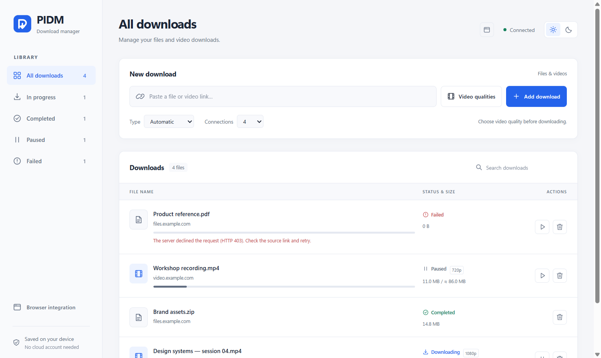

<div align="center">
  
  <h1>PIDM</h1>
  <p><strong>Personal Internet Download Manager</strong></p>
  <p>A Windows download manager for files and supported videos, with browser integration, source quality selection, and light and dark themes.</p>
  <p><a href="#install-on-windows">Install</a> · <a href="#browser-integration">Browser setup</a> · <a href="#run-from-source">Run from source</a> · <a href="#troubleshooting">Troubleshooting</a> · <a href="CONTRIBUTING.md">Contribute</a></p>
</div>

<picture>
  <source media="(prefers-color-scheme: dark)" srcset="docs/images/pidm-dark.png">
  
</picture>

*Interface preview with sample downloads. [Light preview](docs/images/pidm-light.png) · [Dark preview](docs/images/pidm-dark.png)*

## Features

- **File downloads:** up to eight HTTP range connections, with four selected by default; smaller files use fewer requests.
- **Bounded scheduling:** three active downloads, at most two per source hostname. Direct transfers share a pool of twelve response-body leases, capped at eight per requested hostname.
- **Recovery:** direct transfers retry temporary network/HTTP failures up to three times, respect server `Retry-After` delays, and detect stalled requests.
- **Pause and resume:** saved history and partial file recovery across app restarts, where supported by the source server.
- **Video qualities:** choose the resolutions actually offered by the source, including 480p, 720p, 1080p, 1440p and 2160p when available.
- **Audio and video merging:** yt-dlp and FFmpeg handle sources that provide separate streams.
- **Video parallelism:** the Connections selection also sets the video fragment limit, capped at four for supported native HLS/DASH streams. Missing fragments fail the job rather than producing a silently incomplete video.
- **Chrome and Edge integration:** send links through the context menu, extension toolbar or a button over supported video players.
- **Automatic browser connection:** keep PIDM open; no manual pairing code or token copy/paste.
- **Download library:** search, status filters, progress, Pause/Resume and Remove controls.
- **Light and dark themes:** a consistent interface with a saved appearance preference.
- **Self-contained installer:** the Windows build includes Electron, yt-dlp, FFmpeg, FFprobe and the browser extension.

PIDM is independently implemented. It does not contain Internet Download Manager's proprietary code or binaries and is not affiliated with IDM. Website support comes from the available source streams and the bundled video tools; compatibility with every site is not promised.

## Install on Windows

### Requirements

| Requirement | Details |
| --- | --- |
| Operating system | Windows 10 or Windows 11, 64-bit |
| Browser integration | Chrome or Microsoft Edge; optional |
| Internet connection | Required to download files and videos |
| Node.js / Python | Not required for the installed app |

1. Open this repository's **Releases** page and download `PIDM-Setup-<version>-x64.exe`, when a release is available.
2. Run the installer and choose an installation folder.
3. Open **PIDM** from the desktop or Start menu.
4. Paste a direct file link and select **Add download**, or follow the video instructions below.

The current installer is unsigned and has no automatic update service. Obtain it from a release you trust. To update, close PIDM and install the newer release into the same installation folder.

If a release includes `SHA256SUMS.txt`, compare its entry with the checksum of the downloaded installer:

```powershell
Get-FileHash .\PIDM-Setup-0.3.0-x64.exe -Algorithm SHA256
```

## Browser integration

The desktop app works on its own. The browser extension adds download buttons and sends links to it.

1. Open PIDM and select **Browser integration** → **Open extension folder**.
2. In Chrome, open `chrome://extensions`. In Edge, open `edge://extensions`.
3. Enable **Developer mode**, select **Load unpacked**, and choose the folder opened by PIDM.
4. Keep PIDM running. The extension connects automatically when you request a download.
5. Refresh the video page. Use the PIDM toolbar icon or hover over the video player, then choose **Download this video**.

For a direct file link, right-click it and choose **Download with PIDM**.

The extension is currently distributed as an unpacked extension, not through a browser store. Loading it is a one-time step on each browser profile. Source development uses the repository's `extension/` folder instead of the installed app's bundled folder.

**After an update:** select **Reload** on the PIDM extension and refresh open video pages. Close any old quality-selection tabs and open a new one. When upgrading from extension 0.5.0 or earlier, remove the old extension and load the new folder once; later versions use a stable extension identity.

## Download a video

### From the desktop app

1. Paste the video's watch-page URL.
2. Select **Video qualities**.
3. Choose an available resolution.
4. Select **Add download**.

### From your browser

Open the actual video page, then use the PIDM toolbar icon or the button over the player. The quality-selection tab lists the detected resolutions before you start the download.

For YouTube, use a watch, Shorts, live-video or embed URL. A homepage, channel page or playlist page is not a single video. Homepage previews can be used when their own watch link is available; otherwise open the video first.

### How quality and size work

- Resolutions come from the source; PIDM does not invent 4K or upscale a lower-resolution video.
- **Best available** asks the video engine to choose its best available format.
- An explicitly selected resolution must be available. PIDM does not silently replace it with a lower one.
- Audio is included when the source provides it; separate streams are merged with FFmpeg.
- Files retain the source codecs and may use MP4, WebM or MKV containers.
- During a video download, the byte count can describe the current video or audio stream. Estimated totals may change and are not a guaranteed final merged file size.

## Files, history and resume

Downloads and history are stored in:

```text
%USERPROFILE%\Downloads\Personal Downloader\
```

The folder keeps its earlier name to preserve existing downloads. `downloads.json` stores job history. `.parts/` holds positioned file staging data and isolated per-job video working directories. Removing a job clears its owned temporary data; completed files remain.

New direct transfers write disjoint ranges into one staging file and publish it without a second full-file merge copy on filesystems supporting hard links. Other supported filesystems use an exclusive copy fallback. Byte offsets are checkpointed only after syncing their data. A crash can require re-downloading bytes written after the most recent checkpoint; graceful Pause/Exit saves the current prefixes after all writers stop.

Older per-part direct downloads are migrated on resume after source validators are checked. Older video partial files in the download root are preserved, but are not moved or deleted automatically because they do not have the new per-job ownership layout; those jobs may restart in a new working directory.

**Remove** stops an unfinished job and removes its library entry. Completed files stay on disk. Removing a job or uninstalling PIDM does not delete completed downloads.

Direct file resume depends on the server. PIDM checks a stable `ETag` or `Last-Modified` value before reusing range parts. If the server cannot provide a safe resume path, the file starts again from the beginning. Servers without range support use one connection. Video resume depends on the extractor and the source stream.

## Run from source

### Prerequisites

- Windows 10/11 x64.
- Node.js **24.x** and npm. Development has been exercised with Node.js 24.22.1.
- PowerShell, `curl.exe` and `tar.exe` available on `PATH`.
- Git if cloning the repository.

Clone this repository or download its source ZIP. Open PowerShell in the project root, then run:

```powershell
npm ci
npm run setup:media
npm run setup:ffmpeg
npm start
```

`npm ci` installs the locked dependencies and runs the Electron installation script. The setup scripts download pinned third-party tools into the project and verify SHA-256 checksums. They do not install Node.js or Python and do not add the video tools to your system `PATH`.

To run the same local UI without an Electron window:

```powershell
npm run start:browser
```

Open `http://127.0.0.1:17341/` and keep that terminal running. Only one PIDM server can use that port at a time.

### Commands

| Command | Purpose |
| --- | --- |
| `npm start` | Run the Electron desktop app |
| `npm run start:browser` | Run the local HTTP UI without Electron |
| `npm run setup:media` | Install and verify the pinned yt-dlp executable |
| `npm run setup:ffmpeg` | Install and verify the pinned FFmpeg build |
| `npm run assets` | Regenerate app/extension icons and shared extension styles |
| `npm test` | Run the default automated test suite |
| `npm run test:ui` | Verify themes and UI controls in an isolated fixture window |
| `npm run pack:dir` | Build the unpacked Windows application |
| `npm run dist` | Build the Windows NSIS installer |
| `npm run test:packaged` | Exercise the unpacked app with a local video/audio fixture |
| `npm run bench:downloads` | Measure a 32 MiB local direct download with a 1,000-entry history |

### Tests

```powershell
npm test
npm run test:ui
```

Default tests cover file reconstruction, resume, migration, queue/connection limits, retries, server cooldowns, stalls, shutdown/final cleanup, local API authentication, automatic extension connection, video quality projection and browser source selection. The UI check uses sample jobs and saves previews under `ui-preview/`.

To include the real yt-dlp/FFmpeg tests with local media fixtures:

```powershell
$env:TEST_REAL_MEDIA = '1'
npm test
Remove-Item Env:TEST_REAL_MEDIA
```

These include a local DASH fixture with separate audio and exact 480p, 720p, 1080p, 1440p and 2160p output checks, plus a real HLS test for parallel fragments and incomplete-stream failure. Local fixture tests do not establish that every public website works.

The Connections setting is a maximum, not a promise of higher speed. Small files may use one connection; video formats without native fragments do not gain fragment parallelism. A server-requested wait longer than two minutes stops automatic attempts with a retry-later message. See [measured performance and limitations](docs/PERFORMANCE.md).

## Build a Windows installer

After completing source setup:

```powershell
npm run assets
npm run dist
```

Output:

```text
release/
  PIDM-Setup-<version>-x64.exe
  win-unpacked/
    PIDM.exe
```

The installer bundles its runtime and media tools, so recipients do not need a developer environment. The browser extension still needs to be loaded once.

Close the running PIDM app before packaged verification:

```powershell
npm run test:packaged
```

To test an installed copy at its default PIDM installation path:

```powershell
node scripts/smoke-packaged.cjs "$env:LOCALAPPDATA\Programs\PIDM\PIDM.exe"
```

Use your chosen installation path if it differs. The smoke check launches the app without external Node.js on its `PATH`, downloads a local 720p fixture, verifies merged audio, and removes its own test job and output.

Before publishing an installer, follow [Distribution and third-party licensing](docs/DISTRIBUTION.md). Building an EXE is separate from preparing a compliant public binary release.

## Tech stack

| Area | Implementation |
| --- | --- |
| Desktop shell | Electron 45 |
| Application code | JavaScript with Node.js APIs; ES modules and CommonJS entry scripts |
| UI | HTML, CSS, vanilla JavaScript and SVG icons |
| File transfer | Node.js HTTP/fetch streams with segmented range downloads |
| Local service | Node.js HTTP server on `127.0.0.1:17341` |
| Video extraction | yt-dlp |
| Media merging/inspection | FFmpeg and FFprobe |
| Browser extension | Chrome/Edge Manifest V3 |
| Persistence | JSON history and partial files on local disk |
| Windows packaging | electron-builder with NSIS |

```text
assets/        App logo and generated desktop icons
distribution/  Installer instructions and third-party notices
extension/     Browser worker, player button, quality picker and connection UI
fixtures/      Test-only media engine fixtures
scripts/       Tool setup, asset generation, packaging and verification
src/           Desktop entry, HTTP API, file downloads and media integration
test/          Automated regression and integration tests
web/           Desktop/browser UI and shared visual assets
```

## Troubleshooting

| Problem | What to check |
| --- | --- |
| Extension says to open PIDM | Start the desktop app on the same computer. Update both the app and extension, reload the extension, then refresh the website. |
| Video qualities cannot be read | Use the actual video URL. Close old quality tabs and refresh the page after an extension update. Try the same URL in the desktop app to separate browser detection from extraction. |
| HTTP 403 | The source denied access. The URL may have expired, require login or reject the available request context. Obtain a fresh source link. Browser cookies are not imported. |
| HTTP 429 | The source is rate limiting requests. Wait before retrying and reduce connections where applicable. Repeatedly pressing Resume does not remove a server limit. |
| Video works in the browser but not in PIDM | The site may require authentication, DRM, a supported extractor or browser state PIDM does not transfer. Playback does not guarantee an accessible download stream. |
| Requested quality is unavailable | Refresh the quality list and choose a resolution actually offered by that source. |
| Video tools are missing in development | Run `npm run setup:media` and `npm run setup:ffmpeg`. |
| File missing / `ENOENT` | Check whether the file or download folder was moved or deleted. Verify that your account can write to the download folder. |
| Download starts again after Pause | The server may not support ranges or provide a usable validator. Restarting avoids combining unverified bytes. |
| Local connection is already in use | Close the other PIDM instance or development server using port 17341. |
| FFmpeg extraction fails during setup | Check that the Windows `tar.exe` on `PATH` supports the downloaded `.7z` archive, and that sufficient disk space is available. |

## Scope and privacy

The app listens on loopback, uses local API authentication internally, and requires no account or cloud backend. Automatic browser connection is restricted to PIDM's extension origin. Do not expose the local API to another network.

The extension sends the requested page URL and, when exposed by a player, its HTTP media URL and browser user agent to the local app. Browser cookies are not copied. Source URLs are then requested from the relevant websites by the downloader.

DRM removal, automatic browser-wide download interception, cookie import, guaranteed access to authenticated streams, macOS/Linux packaging and automatic updates are not implemented. Website changes can break extraction independently of PIDM releases. Download only content you are permitted to save.

## Contributing

Bug reports and pull requests are welcome. See [CONTRIBUTING.md](CONTRIBUTING.md) for development checks and useful reproduction details. Keep private URLs, credentials and personal download histories out of public issues.

## License and credits

PIDM's own source code is licensed under the **[MIT License](LICENSE)**.

Third-party components retain their own licenses. Electron includes its own and Chromium's notices. yt-dlp's source license differs from the licensing of its bundled Windows executable; the current PyInstaller executable includes GPLv3+ components. The selected Gyan FFmpeg build is GPLv3.

See [third-party notices](distribution/THIRD-PARTY-NOTICES.txt) and [distribution guidance](docs/DISTRIBUTION.md). PIDM's MIT license does not relicense these binaries or remove their distribution requirements.

Thanks to [Electron](https://www.electronjs.org/), [yt-dlp](https://github.com/yt-dlp/yt-dlp), [FFmpeg](https://ffmpeg.org/) and [Gyan's Windows builds](https://www.gyan.dev/ffmpeg/builds/).
